# ESPECIFICACIÓN DE REQUISITOS DE SOFTWARE (SRS)
## Sistema de Gestión de Mantenimiento Computarizado Corporativo e Inteligente (CMMS)
### Proyecto: MantiFix Enterprise
**Versión:** 1.0.0  
**Fecha:** Noviembre 2026  
**Estado:** Aprobado para Fase de Construcción y Verificación  

---

## ÍNDICE GENERAL

1. [INTRODUCCIÓN](#1-introducción)
   - 1.1 [Planteamiento del Problema](#11-planteamiento-del-problema)
   - 1.2 [Propósito del Documento](#12-propósito-del-documento)
   - 1.3 [Justificación](#13-justificación)
     - 1.3.1 [Justificación con Vigilancia Tecnológica](#131-justificación-con-vigilancia-tecnológica)
   - 1.4 [Alcances del Sistema](#14-alcances-del-sistema)
   - 1.5 [Personal Involucrado](#15-personal-involucrado)
   - 1.6 [Definiciones, Acrónimos y Abreviaturas](#16-definiciones-acrónimos-y-abreviaturas)
   - 1.7 [Referencias Normativas y Técnicas](#17-referencias-normativas-y-técnicas)
   - 1.8 [Objetivos del Proyecto](#18-objetivos-del-proyecto)
     - 1.8.1 [Objetivo General](#181-objetivo-general)
     - 1.8.2 [Objetivos Específicos](#182-objetivos-específicos)
   - 1.9 [Resumen Ejecutivo](#19-resumen-ejecutivo)
2. [DESCRIPCIÓN GENERAL](#2-descripción-general)
   - 2.1 [Perspectiva del Producto](#21-perspectiva-del-producto)
   - 2.2 [Características y Perfiles de Usuario](#22-características-y-perfiles-de-usuario)
   - 2.3 [Restricciones del Sistema](#23-restricciones-del-sistema)
   - 2.4 [Suposiciones y Dependencias](#24-suposiciones-y-dependencias)
3. [REQUISITOS ESPECÍFICOS](#3-requisitos-específicos)
   - 3.1 [Interfaces Comunes](#31-interfaces-comunes)
     - 3.1.1 [Interfaces de Usuario (UI)](#311-interfaces-de-usuario-ui)
     - 3.1.2 [Interfaces de Hardware](#312-interfaces-de-hardware)
     - 3.1.3 [Interfaces de Software](#313-interfaces-de-software)
     - 3.1.4 [Interfaces de Comunicación](#314-interfaces-de-comunicación)
   - 3.2 [Historias de Usuario (HU)](#32-historias-de-usuario-hu)
   - 3.2.1 [Casos de Uso Detallados (CU)](#321-casos-de-uso-detallados-cu)
   - 3.3 [Requerimientos Funcionales (RF)](#33-requerimientos-funcionales-rf)
   - 3.4 [Requerimientos No Funcionales (RNF)](#34-requerimientos-no-funcionales-rnf)
4. [SUPUESTOS Y DATOS PARA AFINAR EL SISTEMA](#4-supuestos-y-datos-para-afinar-el-sistema)

---

## 1. INTRODUCCIÓN

### 1.1 Planteamiento del Problema
En las infraestructuras corporativas, hospitalarias, hoteleras y de parques industriales modernos, la gestión operativa de activos críticos (equipos de climatización HVAC, subestaciones eléctricas, grupos electrógenos, bancos de baterías UPS, sistemas de elevación vertical, motobombas y controles de acceso perimetral) enfrenta retos severos de fragmentación, falta de trazabilidad y tiempos de respuesta dilatados:

1. **Gestión Desconectada y Reactiva:** Gran parte de las órdenes de trabajo e incidentes correctivos se reportan mediante llamadas telefónicas, correos electrónicos o mensajería instantánea no estructurada. Esta práctica provoca la pérdida de solicitudes, duplicidad de esfuerzos y carencia de un registro cronológico inmutable.
2. **Invisibilidad de Niveles de Servicio (SLA):** La supervisión gerencial no cuenta con mecanismos en tiempo real para alertar sobre órdenes a punto de expirar según su criticidad (Baja, Media, Alta, Crítica), generando incumplimientos contractuales y multas operativas.
3. **Descoordinación de Cuadrillas Técnicas:** Los despachadores asignan órdenes de mantenimiento sin visibilidad inmediata sobre los turnos laborales activos (Matutino, Vespertino, Nocturno) ni sobre la especialidad técnica requerida (HVAC, Eléctrico, Elevadores, Hidráulico, Seguridad Electrónica), derivando en retrasos en la primera visita e ineficiencia de costos.
4. **Ausencia de Diagnóstico Asistido y Análisis Predictivo:** El personal técnico en campo carece de acceso instantáneo a esquemas de diagnóstico guiado por IA o análisis de telemetría de sensores (BMS/IoT), dependiendo exclusivamente de la intuición individual.
5. **Opacidad en Auditorías y Repuestos:** No existe una bitácora fidedigna con marcas de tiempo (timestamping) que certifique la trazabilidad de intervenciones, cambios de estado ni los insumos consumidos.

### 1.2 Propósito del Documento
El presente documento de Especificación de Requisitos de Software (SRS) formaliza los requisitos funcionales, no funcionales, reglas de negocio, modelos de casos de uso e historias de usuario para el desarrollo e implantación de **MantiFix Enterprise**. Este documento constituye la base contractual y técnica para el equipo de desarrollo, control de calidad (QA), arquitectura de software y líderes de operaciones.

### 1.3 Justificación
La implementación de MantiFix Enterprise resuelve las pérdidas económicas provocadas por tiempos de inactividad no planificados (*downtime*) y optimiza la productividad del personal técnico. Al consolidar la recepción de solicitudes, la priorización automática con temporizadores de SLA regresivos, el despacho inteligente por turno/especialidad, la bitácora inmutable de eventos y el diagnóstico predictivo con Inteligencia Artificial, la organización eleva el tiempo medio entre fallos (MTBF), reduce drásticamente el tiempo medio de reparación (MTTR) y garantiza el cumplimiento estricto de auditorías de calidad (ISO 55000 / ISO 9001).

#### 1.3.1 Justificación con Vigilancia Tecnológica
El análisis de vigilancia tecnológica y estado del arte en software de mantenimiento corporativo revela tres macrotendencias globales:
- **Transición de Mantenimiento Preventivo a Predictivo Basado en Condición (CBM):** La integración de telemetría IoT y modelos de lenguaje de gran escala (LLMs) permite correlacionar anomalías de vibración, temperatura y consumo eléctrico con historiales de averías, reduciendo fallas catastróficas hasta en un 38%.
- **Arquitecturas Ligeras con Alta Eficiencia de Recursos:** Las organizaciones demandan backends de alta disponibilidad y bajo consumo de memoria que puedan operar *on-premise* o en centros de datos periféricos (*edge computing*) sin sobrecostos de licencias ni dependencias infladas.
- **Microfrontends Responsivos y PWA:** La interfaz para operadores y técnicos requiere estándares web modernos (Vite, TypeScript, Tailwind CSS) capaces de funcionar en pantallas táctiles industriales, tabletas rugerizadas y estaciones de monitoreo sin degradación de latencia.

### 1.4 Alcances del Sistema
MantiFix Enterprise abarca:
- **Módulo de Gestión de Activos:** Catálogo de activos físicos con clasificación por criticidad, ubicación física jerárquica (piso, ala, sala técnica), especificaciones de fabricante y estado operativo.
- **Módulo de Órdenes de Trabajo (OT):** Ciclo de vida completo (`CREADA`, `ASIGNADA`, `EN_PROGRESO`, `EN_ESPERA_REPUESTO`, `COMPLETADA`, `CANCELADA`) con identificación unificada correlativa (`MNT-XXXX`).
- **Módulo de SLAs Dinámicos:** Asignación automática de tiempo máximo de resolución según criticidad (Crítica: 2 horas, Alta: 8 horas, Media: 24 horas, Baja: 72 horas), cronómetro en tiempo real y detección de violaciones de SLA.
- **Módulo de Cuadrillas y Turnos:** Registro de personal técnico, certificación por especialidades y filtrado activo según el turno de guardia.
- **Módulo de Diagnóstico Asistido por IA:** Motor híbrido con integración a Google Gemini API para generación de hipótesis de causa raíz y árbol de decisión heurístico de contingencia local.
- **Módulo de Telemetría IoT:** Ingesta y visualización de lecturas de sensores de campo (temperatura, vibración, presión, voltaje).
- **Módulo de Auditoría y Bitácora:** Registro de eventos inmutables cronológicos vinculados a cada orden de trabajo.

**Exclusiones:**
- Módulo de facturación fiscal electrónica directa (se prevé exportación e integración vía API con sistemas ERP externos).
- Gestión de nómina y salarios de personal.

### 1.5 Personal Involucrado
| Rol en el Proyecto | Nombre / Cargo | Responsabilidad Principal |
| :--- | :--- | :--- |
| **Líder de Proyecto / Analista** | William Jiménez Vélez | Definición de requisitos, arquitectura del sistema y gestión del repositorio. |
| **Desarrollador Backend Java** | Equipo de Desarrollo Backend | Implementación de APIs REST, lógica de negocio y persistencia en Java 21. |
| **Desarrollador Frontend Web** | Equipo de Desarrollo Frontend | Interfaces React/TypeScript, diseño responsivo y consumo de servicios. |
| **Especialista de Calidad (QA)** | Ingeniero de Aseguramiento de Calidad | Pruebas de integración, verificación de criterios de aceptación y homologación. |
| **Administrador del Sistema** | Coordinador General de Mantenimiento | Configuración global, administración de usuarios y catálogo de activos. |
| **Técnico de Campo** | Cuadrillas Operativas de Mantenimiento | Ejecución de órdenes de trabajo, reporte de avances y consumo de repuestos. |

### 1.6 Definiciones, Acrónimos y Abreviaturas
- **CMMS:** *Computerized Maintenance Management System* (Sistema de Gestión de Mantenimiento Computarizado).
- **OT / WO:** Orden de Trabajo (*Work Order*).
- **SLA:** *Service Level Agreement* (Acuerdo de Nivel de Servicio).
- **MTTR:** *Mean Time To Repair* (Tiempo Medio de Reparación).
- **MTBF:** *Mean Time Between Failures* (Tiempo Medio Entre Fallos).
- **CBM:** *Condition-Based Maintenance* (Mantenimiento Basado en Condición).
- **REST:** *Representational State Transfer*.
- **JSON:** *JavaScript Object Notation*.
- **HVAC:** *Heating, Ventilation, and Air Conditioning* (Calefacción, Ventilación y Aire Acondicionado).
- **UPS:** *Uninterruptible Power Supply* (Sistema de Alimentación Ininterrumpida).
- **BMS:** *Building Management System* (Sistema de Automatización de Edificios).

### 1.7 Referencias Normativas y Técnicas
- **ISO/IEC/IEEE 29148:2018:** *Systems and software engineering — Life cycle processes — Requirements engineering*.
- **ISO 55000 / ISO 55001:2014:** *Asset management — Overview, principles and terminology / Management systems — Requirements*.
- **RFC 7231:** *Hypertext Transfer Protocol (HTTP/1.1): Semantics and Content*.
- **RFC 8259:** *The JavaScript Object Notation (JSON) Data Interchange Format*.
- **Guía Técnica de Estándares Java SE 21:** Oracle Corporation / OpenJDK Community.

### 1.8 Objetivos del Proyecto

#### 1.8.1 Objetivo General
Desarrollar e implementar un sistema de software integral para la gestión de mantenimiento corporativo (MantiFix Enterprise) que centralice el ciclo de vida de órdenes de trabajo, controle SLAs dinámicos, gestione activos críticos e incorpore diagnóstico asistido por IA, garantizando alta disponibilidad, auditabilidad inmutable y tiempos de respuesta reducidos.

#### 1.8.2 Objetivos Específicos
1. Centralizar y automatizar el registro, categorización y despacho de órdenes de trabajo (`MNT-XXXX`) eliminando la duplicidad y omisión de solicitudes.
2. Implementar un motor de control de SLA con cronómetros regresivos dinámicos y banderas visuales de incumplimiento.
3. Proveer un módulo de asignación inteligente de técnicos basado en compatibilidad de especialidades técnicas y turnos laborales vigentes.
4. Integrar un subsistema de diagnóstico asistido por inteligencia artificial que provea hipótesis técnicas y pasos de mitigación al personal de campo.
5. Garantizar la trazabilidad del 100% de las intervenciones a través de una línea de tiempo (*timeline*) cronológica e inmutable.
6. Diseñar una arquitectura desacoplada con backend en Java 21 y frontend moderno para asegurar una latencia de respuesta inferior a 200 ms en operaciones locales.

### 1.9 Resumen Ejecutivo
MantiFix Enterprise representa una solución corporativa de última generación orientada a resolver las ineficiencias críticas del mantenimiento industrial e inmobiliario. Con una arquitectura web robusta, control riguroso de tiempos de atención y capacidades predictivas, la plataforma optimiza el gasto operativo (OPEX), incrementa la vida útil de los activos críticos y asegura un entorno de trabajo seguro y certificado.

---

## 2. DESCRIPCIÓN GENERAL

### 2.1 Perspectiva del Producto
MantiFix Enterprise es una solución autónoma, modular y basada en arquitectura cliente-servidor distribuida:
- **Capa de Presentación:** Aplicación web de página única (SPA) desarrollada con React 19, TypeScript y Vite, que ofrece dashboards operacionales, formularios reactivos y visualizadores de telemetría.
- **Capa de Lógica de Negocio y Servicios:** Servidor backend implementado en Java 21 utilizando el servidor HTTP ligero nativo de alto rendimiento (`jdk.httpserver`), estructurado bajo el patrón Modelo-Controlador-Servicio sin sobrecarga de frameworks pesados.
- **Capa de Persistencia:** Almacenamiento transaccional estructurado en memoria con soporte de exportación JSON/SQL y capacidad de persistencia desacoplada.
- **Capa de Integración Externa:** Conectores REST para servicios de inferencia de IA (Google Gemini API) y gateways de telemetría BMS/IoT.

### 2.2 Características y Perfiles de Usuario
El sistema define los siguientes perfiles de usuario con permisos diferenciados:

| Perfil de Usuario | Nivel de Acceso | Descripción y Funciones Principales |
| :--- | :--- | :--- |
| **Administrador General** | Total (Lectura, Escritura, Configuración) | Parametriza activos, define reglas de SLA, gestiona cuentas de usuario y consulta auditorías globales. |
| **Supervisor / Despachador** | Operativo Alto | Crea, prioriza y despacha órdenes de trabajo; monitorea cronómetros de SLA y reasigna órdenes rezagadas. |
| **Técnico de Mantenimiento** | Operativo Asignado | Visualiza órdenes asignadas en su turno; reporta estados (`EN_PROGRESO`, `COMPLETADA`), añade repuestos y solicita diagnósticos asistidos. |
| **Operador de Activo / Solicitante** | Creación y Consulta | Reporta anomalías en equipos, consulta el estado de sus solicitudes y confirma la conformidad del servicio. |
| **Auditor de Calidad y Seguridad** | Solo Lectura / Exportación | Examina líneas de tiempo, evalúa cumplimiento de SLAs y exporta reportes históricos. |

### 2.3 Restricciones del Sistema
1. **Restricción de Lenguaje Backend:** Toda la lógica del servidor, endpoints REST, validaciones de negocio y pruebas automatizadas deben ejecutarse exclusivamente en Java SE 21 o superior.
2. **Restricción de Independencia:** El núcleo del servidor backend debe operar sin requerir dependencias de frameworks masivos externos (Zero-Bloat Architecture), permitiendo despliegues limpios y consumo mínimo de memoria (<64 MB en reposo).
3. **Restricción de Plataforma:** Debe ejecutarse de manera homogénea en sistemas operativos Windows, Linux y macOS.
4. **Restricción de Conectividad:** La aplicación debe mantener funcionalidad operativa plena (gestión de órdenes, bitácoras, cálculo de SLAs) incluso en ausencia de conexión a internet, recurriendo a motores de diagnóstico heurísticos locales cuando la API de IA externa no esté disponible.
5. **Seguridad y Acceso:** La comunicación web debe soportar encabezados estándar de seguridad (CORS configurado, validación de tipos MIME y prevención de inyección de parámetros).

### 2.4 Suposiciones y Dependencias
- Se asume que las estaciones de trabajo de los operadores y técnicos disponen de un navegador web moderno con soporte para ECMAScript 2022+ (Google Chrome, Mozilla Firefox, Microsoft Edge o Safari).
- Se asume que el servidor anfitrión dispone de Java Runtime Environment (JRE) versión 21 de 64 bits instalado y accesible en la variable de entorno PATH.
- Para el funcionamiento del diagnóstico inteligente en la nube se requiere disponibilidad de conexión a internet saliente hacia la API de Google Gemini mediante protocolo HTTPS (puerto 443).

---

## 3. REQUISITOS ESPECÍFICOS

### 3.1 Interfaces Comunes

#### 3.1.1 Interfaces de Usuario (UI)
- **Dashboard Operativo Central:** Vista gerencial que agrupa tarjetas de métricas en tiempo real: Total de OTs, Órdenes en Curso, Órdenes Vencidas (SLA Breach), y Disponibilidad de Activos Críticos.
- **Consola de Órdenes de Trabajo:** Grilla interactiva con búsqueda por texto libre, filtrado por criticidad (`CRITICA`, `ALTA`, `MEDIA`, `BAJA`), estado y especialidad técnica.
- **Ficha Técnica del Activo:** Visualización del estado del equipo, historial de intervenciones previas, telemetría reciente y cronograma de mantenimiento preventivo.
- **Ventana de Diagnóstico Asistido:** Panel modal para solicitar diagnósticos predictivos con visualización de nivel de confianza (%), hipótesis de falla, pasos recomendados y advertencias de seguridad laboral.
- **Línea de Tiempo de Auditoría:** Línea de eventos cronológica que visualiza cada cambio de estado con fecha, hora exacta, usuario responsable y observaciones.

#### 3.1.2 Interfaces de Hardware
- El sistema no interactúa de manera directa con puertos propietarios de bajo nivel; recibe datos de sensores mediante pasarelas (gateways) TCP/IP y puertos USB/RS-485 estandarizados que transforman señales a tramas JSON.
- Compatibilidad con lectores de códigos QR / códigos de barras 2D estándar mediante cámaras web integradas o periféricos HID.

#### 3.1.3 Interfaces de Software
- **Java SE 21 HTTP Server:** Motor de servidor `jdk.httpserver.HttpServer` vinculado a interfaces de red configurables.
- **RESTful Endpoints:**
  - `GET /api/workorders`: Recuperación de colección de órdenes.
  - `POST /api/workorders`: Alta de nueva orden de trabajo.
  - `GET /api/workorders/{id}`: Detalle de orden por identificador unificado.
  - `PUT /api/workorders/{id}/status`: Transición formal de estado.
  - `POST /api/workorders/{id}/diagnose`: Ejecución de diagnóstico asistido por IA.
  - `GET /api/assets`: Consulta de inventario de activos.
  - `GET /api/technicians`: Consulta de técnicos y turnos.
  - `GET /api/stats`: Métricas operativas consolidadas.
- **Google Gemini API Client:** Conexión REST HTTPS para inferencia predictiva asistida.

#### 3.1.4 Interfaces de Comunicación
- **Protocolo de Transporte:** HTTP/1.1 y HTTPS mediante TLS 1.3.
- **Formato de Carga:** Cargas útiles codificadas exclusivamente en `application/json; charset=UTF-8`.
- **Negociación de Origen:** Soporte completo de encabezados CORS (`Access-Control-Allow-Origin: *`, `Access-Control-Allow-Methods: GET, POST, PUT, DELETE, OPTIONS`, `Access-Control-Allow-Headers: Content-Type, Authorization`).

---

### 3.2 Historias de Usuario (HU)

#### HU-01: Registro de Nueva Orden de Trabajo
| Campo | Detalle |
| :--- | :--- |
| **Código** | **HU-01** |
| **Rol** | Como Supervisor de Operaciones |
| **Quiero** | Registrar una nueva orden de trabajo especificando el título, descripción, activo vinculado y nivel de criticidad |
| **Para** | Formalizar la solicitud de mantenimiento y activar el protocolo de atención inmediata |
| **Criterios de Aceptación** | 1. El sistema debe asignar un código único correlativo con formato `MNT-XXXX`. 2. El sistema debe calcular y asociar automáticamente el tiempo límite de SLA según la criticidad seleccionada. 3. El sistema debe rechazar solicitudes que omitan el título, la criticidad o el activo. 4. Se debe registrar el evento inicial en la bitácora inmutable. |
| **Prioridad / Estimación** | Alta / 5 Puntos de Historia |

#### HU-02: Visualización y Filtrado de Órdenes
| Campo | Detalle |
| :--- | :--- |
| **Código** | **HU-02** |
| **Rol** | Como Despachador de Mantenimiento |
| **Quiero** | Filtrar y ordenar la lista de órdenes por estado, criticidad, técnico asignado y alerta de SLA |
| **Para** | Identificar de forma inmediata los incidentes más urgentes que requieren atención prioritaria |
| **Criterios de Aceptación** | 1. La búsqueda debe responder en menos de 200 ms al ingresar términos clave. 2. Los filtros deben poder combinarse (ej. Crítica + En Progreso). 3. Las órdenes con SLA vencido deben resaltarse visualmente en color rojo con un indicador de advertencia. |
| **Prioridad / Estimación** | Alta / 3 Puntos de Historia |

#### HU-03: Asignación Inteligente de Técnico
| Campo | Detalle |
| :--- | :--- |
| **Código** | **HU-03** |
| **Rol** | Como Despachador de Cuadrillas |
| **Quiero** | Asignar una orden de trabajo a un técnico considerando su especialidad y turno laboral activo |
| **Para** | Asegurar que la intervención sea ejecutada por personal calificado y disponible en el horario requerido |
| **Criterios de Aceptación** | 1. El selector de técnicos debe destacar aquellos cuya especialidad coincida con el tipo de activo (HVAC, Eléctrico, etc.). 2. Se debe advertir si el técnico seleccionado no pertenece al turno activo actual. 3. Al confirmar la asignación, el estado de la orden debe cambiar automáticamente a `ASIGNADA` y notificarse en la línea de tiempo. |
| **Prioridad / Estimación** | Alta / 5 Puntos de Historia |

#### HU-04: Transición de Estado de Órdenes
| Campo | Detalle |
| :--- | :--- |
| **Código** | **HU-04** |
| **Rol** | Como Técnico de Mantenimiento |
| **Quiero** | Actualizar el estado de mi orden de trabajo a `EN_PROGRESO`, `EN_ESPERA_REPUESTO` o `COMPLETADA` |
| **Para** | Reflejar el avance real de la intervención y notificar a la supervisión |
| **Criterios de Aceptación** | 1. Las transiciones de estado deben cumplir con la máquina de estados permitida. 2. Toda transición debe exigir una nota u observación obligatoria si se marca como `EN_ESPERA_REPUESTO`. 3. Al marcarse como `COMPLETADA`, el cronómetro de SLA debe detenerse y registrar la fecha de cierre definitiva. |
| **Prioridad / Estimación** | Alta / 5 Puntos de Historia |

#### HU-05: Monitor de SLA en Tiempo Real
| Campo | Detalle |
| :--- | :--- |
| **Código** | **HU-05** |
| **Rol** | Como Coordinador de Mantenimiento |
| **Quiero** | Visualizar cronómetros regresivos de SLA para cada orden activa |
| **Para** | Evitar incumplimientos de contratos y penalizaciones por demoras no gestionadas |
| **Criterios de Aceptación** | 1. El temporizador debe actualizarse dinámicamente mostrando horas y minutos restantes. 2. Cuando el tiempo restante sea menor al 20%, la tarjeta debe cambiar a estado de advertencia (color ámbar). 3. Al llegar a cero, el sistema debe marcar la orden con la bandera booleana `slaBreached: true` y desplegar el distintivo de incumplimiento. |
| **Prioridad / Estimación** | Alta / 5 Puntos de Historia |

#### HU-06: Diagnóstico Asistido por Inteligencia Artificial
| Campo | Detalle |
| :--- | :--- |
| **Código** | **HU-06** |
| **Rol** | Como Técnico de Mantenimiento |
| **Quiero** | Solicitar un análisis asistido por IA para una orden de trabajo abierta |
| **Para** | Recibir hipótesis de causa raíz, procedimientos recomendados y precauciones de seguridad basadas en el síntoma reportado |
| **Criterios de Aceptación** | 1. El sistema debe enviar a la API de IA el título, descripción, tipo de activo y lecturas recientes de sensores. 2. La respuesta debe estructurarse en: Diagnóstico Probable, Nivel de Confianza (%), Acciones Sugeridas y Medidas de Seguridad EPP. 3. Si el servicio de IA en la nube no responde en 5 segundos, debe activarse automáticamente el motor heurístico local sin interrumpir al usuario. |
| **Prioridad / Estimación** | Alta / 8 Puntos de Historia |

#### HU-07: Catálogo de Activos Críticos
| Campo | Detalle |
| :--- | :--- |
| **Código** | **HU-07** |
| **Rol** | Como Administrador de Infraestructura |
| **Quiero** | Administrar el inventario de activos con su código, categoría, marca, modelo, ubicación física y nivel de criticidad |
| **Para** | Mantener un registro veraz de los equipos que componen la infraestructura |
| **Criterios de Aceptación** | 1. Cada activo debe tener un identificador único (ej. `AST-HVAC-01`). 2. Se debe registrar la fecha de instalación y el estado operacional actual (`OPERATIVO`, `DEGRADADO`, `FUERA_DE_SERVICIO`). 3. No se puede eliminar un activo que posea órdenes de trabajo activas en curso. |
| **Prioridad / Estimación** | Media / 5 Puntos de Historia |

#### HU-08: Monitoreo de Telemetría de Activos
| Campo | Detalle |
| :--- | :--- |
| **Código** | **HU-08** |
| **Rol** | Como Ingeniero de Mantenimiento Predictivo |
| **Quiero** | Consultar los datos telemétricos (temperatura, vibración, presión) de los activos |
| **Para** | Detectar anomalías operativas antes de que ocurra una falla catastrófica |
| **Criterios de Aceptación** | 1. La interfaz debe graficar las variables físicas del activo seleccionado en las últimas 24 horas. 2. Las lecturas fuera de rango normativo deben señalarse con umbrales visuales de alarma. 3. Se debe permitir disparar una orden de trabajo preventiva directamente desde una lectura anómala. |
| **Prioridad / Estimación** | Media / 5 Puntos de Historia |

#### HU-09: Trazabilidad y Bitácora Inmutable
| Campo | Detalle |
| :--- | :--- |
| **Código** | **HU-09** |
| **Rol** | Como Auditor de Calidad |
| **Quiero** | Consultar la línea de tiempo completa de eventos de cualquier orden de trabajo |
| **Para** | Verificar fehacientemente quién intervino el equipo, en qué momento exacto y bajo qué justificación |
| **Criterios de Aceptación** | 1. Cada evento debe contener: Timestamp ISO-8601, Usuario, Acción, Estado anterior y Estado resultante. 2. Los eventos de la bitácora son de estricta solo lectura; ningún usuario puede modificarlos ni eliminarlos. 3. La bitácora debe estar visible tanto en el detalle de la orden como en exportaciones oficiales. |
| **Prioridad / Estimación** | Alta / 3 Puntos de Historia |

#### HU-10: Gestión de Repuestos e Insumos
| Campo | Detalle |
| :--- | :--- |
| **Código** | **HU-10** |
| **Rol** | Como Técnico de Mantenimiento |
| **Quiero** | Registrar los repuestos, piezas y consumibles utilizados en una orden de trabajo |
| **Para** | Mantener controlado el inventario de partes y documentar los costos asociados al mantenimiento |
| **Criterios de Aceptación** | 1. Se debe poder seleccionar el repuesto del catálogo o ingresar nombre, cantidad y número de parte. 2. Si no hay existencia en almacén, la orden debe poder ponerse en estado `EN_ESPERA_REPUESTO`. 3. Los repuestos imputados deben reflejarse en el resumen de costos de la orden al completarse. |
| **Prioridad / Estimación** | Media / 5 Puntos de Historia |

#### HU-11: Tablero de Métricas Operativas (KPIs)
| Campo | Detalle |
| :--- | :--- |
| **Código** | **HU-11** |
| **Rol** | Como Gerente de Operaciones |
| **Quiero** | Analizar un tablero de indicadores con porcentaje de cumplimiento de SLA, MTTR promedio y tasa de fallas por activo |
| **Para** | Tomar decisiones estratégicas sobre inversiones en reposición de maquinaria y rediseño de turnos |
| **Criterios de Aceptación** | 1. El sistema debe calcular automáticamente el porcentaje global de SLA alcanzado. 2. El MTTR debe expresarse en horas y minutos discriminado por tipo de activo. 3. Los gráficos deben permitir seleccionar rangos de fecha mensuales y trimestrales. |
| **Prioridad / Estimación** | Media / 5 Puntos de Historia |

#### HU-12: Gestión de Turnos de Cuadrillas
| Campo | Detalle |
| :--- | :--- |
| **Código** | **HU-12** |
| **Rol** | Como Coordinador de Recursos Humanos Operativos |
| **Quiero** | Configurar los turnos laborales (Matutino, Vespertino, Nocturno) y asignar a los técnicos de guardia |
| **Para** | Mantener actualizada la disponibilidad del personal en cada ventana horaria |
| **Criterios de Aceptación** | 1. Cada turno debe definir hora de inicio y fin. 2. El sistema debe determinar en tiempo real qué técnicos están activos en el instante en que se genera una emergencia. 3. Se deben contemplar técnicos en guardia pasiva para contingencias nocturnas. |
| **Prioridad / Estimación** | Media / 3 Puntos de Historia |

#### HU-13: Cierre Técnico y Calificación de Servicio
| Campo | Detalle |
| :--- | :--- |
| **Código** | **HU-13** |
| **Rol** | Como Operador del Activo / Solicitante |
| **Quiero** | Validar la resolución del trabajo realizado por el técnico y calificar la atención |
| **Para** | Cerrar administrativamente la solicitud y retroalimentar el desempeño del equipo |
| **Criterios de Aceptación** | 1. El solicitante debe recibir notificación de que la orden fue marcada como `COMPLETADA`. 2. Puede aceptar la conformidad o rechazarla con una observación (reabriendo la orden a `EN_PROGRESO`). 3. La calificación del servicio debe registrarse en escala del 1 al 5 con campo optativo de comentarios. |
| **Prioridad / Estimación** | Baja / 3 Puntos de Historia |

#### HU-14: Programación de Mantenimiento Preventivo
| Campo | Detalle |
| :--- | :--- |
| **Código** | **HU-14** |
| **Rol** | Como Planificador de Mantenimiento |
| **Quiero** | Crear planes de mantenimiento preventivo recurrentes basados en calendario o en horas de operación |
| **Para** | Generar órdenes automáticas que impidan el deterioro prematuro de los equipos |
| **Criterios de Aceptación** | 1. Se debe permitir definir periodicidad: semanal, mensual, trimestral o semestral. 2. El sistema debe instanciar automáticamente la orden `MNT-XXXX` 48 horas antes del vencimiento del ciclo. 3. La orden preventiva debe precargar la lista de verificación (checklist) estándar del activo. |
| **Prioridad / Estimación** | Media / 5 Puntos de Historia |

#### HU-15: Registro Fotográfico de Evidencias
| Campo | Detalle |
| :--- | :--- |
| **Código** | **HU-15** |
| **Rol** | Como Técnico de Mantenimiento |
| **Quiero** | Adjuntar fotografías del antes y después de la reparación en la orden de trabajo |
| **Para** | Aportar evidencia documental incontrastable del trabajo efectuado |
| **Criterios de Aceptación** | 1. Se deben soportar formatos de imagen JPEG y PNG de hasta 5 MB por archivo. 2. Las imágenes deben visualizarse en una galería dentro de la ficha de la orden. 3. Toda imagen debe quedar ligada de forma permanente al expediente de la orden. |
| **Prioridad / Estimación** | Media / 3 Puntos de Historia |

#### HU-16: Notificaciones de Incumplimiento de SLA
| Campo | Detalle |
| :--- | :--- |
| **Código** | **HU-16** |
| **Rol** | Como Supervisor de Operaciones |
| **Quiero** | Recibir alertas visuales y sonoras inmediatas en la interfaz cuando una orden crítica supere su tiempo de SLA |
| **Para** | Escalar de inmediato el incidente a los jefes de departamento y movilizar recursos adicionales |
| **Criterios de Aceptación** | 1. La alerta debe aparecer como notificación persistente en la cabecera de la aplicación. 2. Debe indicarse claramente el código de orden, tiempo excedido y técnico responsable. 3. Se debe exigir acuse de recibo del supervisor para silenciar la advertencia. |
| **Prioridad / Estimación** | Alta / 3 Puntos de Historia |

#### HU-17: Exportación de Informes de Mantenimiento
| Campo | Detalle |
| :--- | :--- |
| **Código** | **HU-17** |
| **Rol** | Como Auditor o Gerente de Mantenimiento |
| **Quiero** | Exportar el listado histórico de órdenes y sus bitácoras en formatos CSV y JSON |
| **Para** | Procesar auditorías externas y alimentar plataformas de Business Intelligence corporativas |
| **Criterios de Aceptación** | 1. El archivo exportado debe contener todos los campos de cabecera, tiempos reales de resolución y cumplimiento de SLA. 2. La exportación debe respetar los filtros aplicados en pantalla. 3. El proceso de exportación de hasta 5,000 registros no debe tomar más de 3 segundos. |
| **Prioridad / Estimación** | Baja / 2 Puntos de Historia |

#### HU-18: Gestión de Protocolos de Seguridad y Bloqueo (LOTO)
| Campo | Detalle |
| :--- | :--- |
| **Código** | **HU-18** |
| **Rol** | Como Encargado de Seguridad y Salud en el Trabajo |
| **Quiero** | Vincular protocolos de bloqueo físico/etiquetado (Lockout/Tagout - LOTO) a órdenes de activos de alto riesgo |
| **Para** | Garantizar que ningún técnico inicie la reparación de maquinaria de potencia sin desenergizar el sistema |
| **Criterios de Aceptación** | 1. Los activos catalogados como `ALTO_VOLTAJE` o `ALTA_PRESION` deben obligar a marcar la casilla de verificación de protocolo LOTO antes de pasar a `EN_PROGRESO`. 2. El sistema debe solicitar el código del candado o precinto de seguridad aplicado. 3. Queda prohibida la transición de estado si no se cumple esta confirmación. |
| **Prioridad / Estimación** | Alta / 5 Puntos de Historia |

#### HU-19: Autenticación y Control de Sesión RBAC
| Campo | Detalle |
| :--- | :--- |
| **Código** | **HU-19** |
| **Rol** | Como Administrador del Sistema |
| **Quiero** | Gestionar el acceso mediante autenticación segura basada en roles (RBAC) |
| **Para** | Restringir acciones sensibles únicamente a usuarios autorizados |
| **Criterios de Aceptación** | 1. El sistema debe autenticar credenciales y emitir tokens de sesión seguros. 2. Las interfaces operativas deben ocultar o deshabilitar botones según el rol del usuario. 3. Los accesos no autorizados a endpoints protegidos deben devolver código HTTP `403 Forbidden`. |
| **Prioridad / Estimación** | Alta / 5 Puntos de Historia |

#### HU-20: Modo Contingencia y Resiliencia Local
| Campo | Detalle |
| :--- | :--- |
| **Código** | **HU-20** |
| **Rol** | Como Técnico en Zona Aislada / Subterránea |
| **Quiero** | Que el sistema mantenga operatividad local cuando se pierda la conectividad con servicios de nube externos |
| **Para** | Continuar registrando avances y consultando árboles de falla sin interrupción de la jornada laboral |
| **Criterios de Aceptación** | 1. El backend Java debe detectar la indisponibilidad de la API externa de IA en menos de 2 segundos. 2. La aplicación debe sustituir la inferencia remota por el motor heurístico local precargado. 3. Se debe notificar al usuario con el indicador "Modo Diagnóstico Heurístico Local Activo". |
| **Prioridad / Estimación** | Media / 5 Puntos de Historia |

---

### 3.2.1 Casos de Uso Detallados (CU)

```mermaid
flowchart TD
    User([Supervisor / Solicitante]) --> CU01[CU-01: Crear Orden de Trabajo]
    User --> CU02[CU-02: Asignar Técnico a Orden]
    Tech([Técnico de Mantenimiento]) --> CU03[CU-03: Actualizar Estado de OT]
    Tech --> CU04[CU-04: Ejecutar Diagnóstico IA]
    Tech --> CU05[CU-05: Imputar Repuestos]
    System([Motor del Sistema]) --> CU06[CU-06: Monitorear SLA]
    Admin([Administrador / Auditor]) --> CU07[CU-07: Consultar Bitácora]
    Admin --> CU08[CU-08: Gestionar Activos]
    Admin --> CU09[CU-09: Generar Métricas KPIs]
    Tech --> CU10[CU-10: Cierre y Conformidad]
    Supervisor([Supervisor EPP]) --> CU11[CU-11: Validar Protocolo LOTO]
    System --> CU12[CU-12: Disparar Alerta Predictiva]
```

#### CU-01: Crear Orden de Trabajo (MNT-XXXX)
- **Actores:** Supervisor de Operaciones, Operador Solicitante.
- **Precondiciones:** El usuario ha iniciado sesión válida y el activo objeto de la intervención se encuentra dado de alta en el catálogo del sistema.
- **Flujo Principal:**
  1. El usuario accede al formulario de "Nueva Orden de Trabajo".
  2. El usuario ingresa: Título de la solicitud, Descripción detallada de la anomalía, Selección del Activo y Nivel de Criticidad (`BAJA`, `MEDIA`, `ALTA`, `CRITICA`).
  3. El usuario envía la solicitud mediante el botón "Crear Orden".
  4. El servidor valida la completitud y formato de los datos obligatorios.
  5. El servidor genera el código unificado correlativo (ej. `MNT-1001`).
  6. El servidor calcula el `slaDeadline` basándose en la criticidad y fija el estado inicial en `CREADA`.
  7. El servidor registra el evento inaugural en la bitácora (`TimelineEvent`).
  8. El sistema retorna la orden creada con código HTTP `201 Created` y la despliega en pantalla.
- **Flujos Alternativos:**
  - *4a. Datos Incompletos:* Si falta el título, activo o criticidad, el servidor responde con código HTTP `400 Bad Request` indicando los campos faltantes. El formulario resalta los campos en rojo y no se registra la orden.
  - *4b. Activo Inexistente o Inactivo:* Si el activo seleccionado se encuentra dado de baja, el sistema emite alerta y sugiere seleccionar un equipo en servicio.
- **Postcondiciones:** La orden de trabajo queda registrada en el sistema con temporizador de SLA activo y disponible para asignación.

#### CU-02: Asignar Técnico a Orden de Trabajo
- **Actores:** Supervisor / Despachador de Mantenimiento.
- **Precondiciones:** La orden de trabajo existe en estado `CREADA` o `ASIGNADA` (reasignación).
- **Flujo Principal:**
  1. El supervisor selecciona la orden de trabajo en la consola de despacho.
  2. El supervisor abre el selector de técnicos disponibles.
  3. El sistema lista a los técnicos filtrados por turno activo y resalta con etiqueta de compatibilidad a los que poseen la especialidad afín al activo.
  4. El supervisor selecciona al técnico idóneo y confirma la asignación.
  5. El sistema actualiza el campo `assignedTechnician` y transiciona el estado a `ASIGNADA`.
  6. Se añade un evento a la bitácora con el nombre del supervisor y del técnico receptor.
  7. El sistema notifica la asignación en la interfaz del técnico.
- **Flujos Alternativos:**
  - *4a. Técnico Asignado Fuera de Turno:* El sistema despliega un diálogo de advertencia: *"El técnico seleccionado pertenece al turno Nocturno y el turno actual es Matutino. ¿Desea proceder con recargo de guardia pasiva?"*. Si el supervisor acepta, se registra la excepción en la bitácora; si declina, regresa al paso 3.
- **Postcondiciones:** La orden pasa al estado `ASIGNADA` y se refleja en la bandeja de trabajo del técnico.

#### CU-03: Actualizar Estado de la Orden de Trabajo
- **Actores:** Técnico de Mantenimiento.
- **Precondiciones:** El técnico tiene asignada la orden de trabajo.
- **Flujo Principal:**
  1. El técnico ingresa al detalle de la orden en su consola de trabajo.
  2. El técnico selecciona el nuevo estado deseado (`EN_PROGRESO`, `EN_ESPERA_REPUESTO` o `COMPLETADA`).
  3. El técnico añade una nota descriptiva de la intervención o motivo de pausa.
  4. El sistema valida que la transición sea permitida según el grafo de estados.
  5. El sistema persiste el nuevo estado, actualiza las marcas temporales correspondientes y registra el evento inmutable en el timeline.
  6. Si el estado nuevo es `COMPLETADA`, el sistema detiene el temporizador de SLA y fija la fecha de cierre.
- **Flujos Alternativos:**
  - *4a. Transición No Permitida:* Si el técnico intenta pasar directamente de `CREADA` a `COMPLETADA` sin pasar por `EN_PROGRESO`, el sistema rechaza la operación con código HTTP `400 Bad Request` explicando la secuencia obligatoria.
  - *4b. Falta de Justificación en Espera de Repuesto:* Si se selecciona `EN_ESPERA_REPUESTO` y el campo de notas está en blanco, el sistema bloquea el guardado y exige detallar la pieza faltante.
- **Postcondiciones:** La orden de trabajo refleja su nuevo estado operacional en tiempo real para todos los roles.

#### CU-04: Ejecutar Diagnóstico Asistido por Inteligencia Artificial
- **Actores:** Técnico de Mantenimiento, Supervisor.
- **Precondiciones:** La orden de trabajo contiene descripción del síntoma y el activo cuenta con tipo de máquina tipificado.
- **Flujo Principal:**
  1. El usuario pulsa el botón "Solicitar Diagnóstico IA" en el panel de la orden.
  2. El frontend emite una solicitud `POST /api/workorders/{id}/diagnose`.
  3. El backend Java recopila los datos de la orden, categoría de activo y últimas lecturas telemétricas.
  4. El backend invoca el servicio de inferencia de Google Gemini API transmitiendo el prompt estructurado.
  5. La API de IA devuelve un objeto JSON estructurado con: Diagnóstico Probable, Nivel de Confianza (0-100%), Lista de Causas Raíz, Acciones de Reparación Recomendadas y Advertencias de Seguridad EPP.
  6. El backend almacena el resultado en el campo `diagnosticAi` de la orden y genera un evento de auditoría.
  7. El frontend renderiza visualmente el diagnóstico en un panel interactivo.
- **Flujos Alternativos:**
  - *4a. Falla de Conectividad o Timeout de API Externa:* Si la llamada remota falla o excede el umbral de 3,000 ms, el subsistema captura la excepción `AiConnectionException` y redirige la solicitud inmediatamente al motor heurístico interno (`LocalDiagnosticFallbackEngine`).
  - *5a. Respuesta de Contingencia Local:* El motor heurístico analiza palabras clave del síntoma y retorna un diagnóstico determinista marcando `engineSource: "LOCAL_HEURISTIC"`.
- **Postcondiciones:** El diagnóstico queda adjunto a la orden de trabajo para consulta del equipo técnico.

#### CU-05: Imputar Repuestos y Materiales a la Orden
- **Actores:** Técnico de Mantenimiento.
- **Precondiciones:** La orden se encuentra en estado `EN_PROGRESO`.
- **Flujo Principal:**
  1. El técnico accede a la pestaña "Repuestos y Materiales" dentro de la orden.
  2. El técnico selecciona el ítem del catálogo o escribe el nombre del componente, número de parte y cantidad utilizada.
  3. El sistema valida la disponibilidad y asocia el material a la orden.
  4. Se actualiza el costo acumulado de materiales de la orden de trabajo.
  5. Se registra la imputación en el historial inmutable.
- **Flujos Alternativos:**
  - *3a. Repuesto sin Stock:* Si la cantidad solicitada supera las existencias, el sistema ofrece cambiar el estado de la orden a `EN_ESPERA_REPUESTO` y remitir solicitud automática a compras.
- **Postcondiciones:** Los insumos quedan formalmente cargados al expediente del mantenimiento y descargados del inventario operativo.

#### CU-06: Monitorear Tiempos de Nivel de Servicio (SLA)
- **Actores:** Motor Automático del Sistema (Daemon/Scheduler).
- **Precondiciones:** Existen órdenes de trabajo abiertas en estados diferentes a `COMPLETADA` o `CANCELADA`.
- **Flujo Principal:**
  1. El motor del sistema evalúa periódicamente el diferencial temporal: `tiempoRestante = slaDeadline - tiempoActual`.
  2. Si `tiempoRestante > 0`, calcula el porcentaje de tiempo consumido.
  3. Si el tiempo consumido excede el 80%, clasifica la orden en advertencia y emite aviso visual en el dashboard.
  4. Si `tiempoRestante <= 0` y la bandera `slaBreached` es falsa:
     - Fija `slaBreached = true`.
     - Registra una advertencia en la bitácora: `"SLA Incumplido: Excedido el límite máximo de atención"`.
     - Dispara notificación prioritaria a los supervisores de turno.
- **Flujos Alternativos:**
  - *4a. Orden Pausada por Justificación Aprobada:* Si la orden está en `EN_ESPERA_REPUESTO` con justificación formal aprobada por el supervisor, el cómputo de SLA puede pausarse de acuerdo con la política interna de la organización.
- **Postcondiciones:** El estado de cumplimiento de SLA se mantiene actualizado segundo a segundo en todo el sistema.

#### CU-07: Consultar Bitácora Inmutable de Auditoría
- **Actores:** Auditor de Calidad, Gerente de Mantenimiento, Supervisor.
- **Precondiciones:** El usuario dispone de credenciales con permiso de lectura de auditoría.
- **Flujo Principal:**
  1. El usuario selecciona una orden de trabajo e ingresa a la sección "Historial de Auditoría".
  2. El sistema recupera la lista secuencial de `TimelineEvent` ordenados cronológicamente por marca de tiempo ascendente.
  3. Se despliegan en pantalla los eventos con autor, fecha/hora, acción realizada y notas de transición.
  4. El usuario puede aplicar filtros por usuario o tipo de acción.
  5. El usuario puede pulsar "Exportar Bitácora" para generar un archivo descargable.
- **Flujos Alternativos:**
  - *3a. Intento de Modificación:* Ninguna interfaz ni endpoint permite operaciones `DELETE` o `UPDATE` sobre la tabla de eventos de auditoría. Todo intento es denegado por diseño a nivel de arquitectura.
- **Postcondiciones:** Se emite la consulta de auditoría sin alterar ningún registro histórico.

#### CU-08: Gestionar Catálogo de Activos Físicos
- **Actores:** Administrador de Mantenimiento.
- **Precondiciones:** El usuario posee permisos administrativos.
- **Flujo Principal:**
  1. El administrador ingresa al módulo "Gestión de Activos".
  2. Selecciona la opción "Crear Activo".
  3. Diligencia los datos: Código de activo, Nombre, Categoría (HVAC, Eléctrico, Elevadores, Hidráulico, etc.), Fabricante, Modelo, Ubicación física (Edificio, Piso, Sala) y Nivel de Criticidad.
  4. El sistema valida la unicidad del código de activo.
  5. Se almacena el activo y queda disponible para vincular a órdenes de trabajo preventivas y correctivas.
- **Flujos Alternativos:**
  - *4a. Código de Activo Duplicado:* El sistema rechaza la creación y notifica que ya existe un equipo con dicho identificador.
- **Postcondiciones:** El nuevo activo queda formalmente incorporado al catálogo corporativo.

#### CU-09: Generar Reportes y KPIs de Mantenimiento
- **Actores:** Gerente de Operaciones, Planificador de Mantenimiento.
- **Precondiciones:** Existen órdenes cerradas y abiertas en la base de datos dentro del período de análisis.
- **Flujo Principal:**
  1. El usuario accede al módulo "Reportes y Métricas".
  2. Selecciona el rango temporal (Semana, Mes, Trimestre, Año) y opcionalmente filtra por categoría de activo o cuadrilla.
  3. El sistema calcula y grafica:
     - Porcentaje de Cumplimiento de SLA = `(OTs cumplidas / OTs totales) * 100`.
     - MTTR (Mean Time to Repair) promedio.
     - Distribución de fallas por activo y subsistema.
  4. El usuario solicita la descarga en formato CSV o informe estructurado.
- **Flujos Alternativos:**
  - *3a. Período sin Datos:* Si no existen órdenes registradas en el intervalo seleccionado, el sistema despliega el mensaje de aviso *"No se registran intervenciones en el período seleccionado"* y deshabilita la exportación.
- **Postcondiciones:** Los indicadores son calculados y exportados para análisis directivo.

#### CU-10: Cierre Técnico y Conformidad del Servicio
- **Actores:** Operador Solicitante / Supervisor de Área, Técnico de Mantenimiento.
- **Precondiciones:** La orden de trabajo se encuentra en estado `COMPLETADA` por el técnico ejecutor.
- **Flujo Principal:**
  1. El solicitante revisa el equipo intervenido en su área física.
  2. Ingresa al sistema y localiza la orden en estado `COMPLETADA`.
  3. Verifica las notas técnicas, los repuestos utilizados y las evidencias fotográficas adjuntas.
  4. Selecciona la opción "Aprobar Conformidad".
  5. Asigna una calificación al servicio (1 a 5 estrellas) y opcionalmente añade un comentario cualitativo.
  6. El sistema archiva definitivamente la orden y registra la conformidad en la bitácora.
- **Flujos Alternativos:**
  - *4a. Rechazo por No Conformidad:* Si el equipo continúa presentando fallas o la limpieza del área es deficiente, el solicitante selecciona "Rechazar Conformidad", ingresa el motivo detallado y el sistema reabre la orden retornándola al estado `EN_PROGRESO`, reactivando la asignación al técnico responsable.
- **Postcondiciones:** La orden queda formalmente cerrada con conformidad de cliente interno o reabierta para subsanación.

#### CU-11: Validar Protocolo de Seguridad LOTO (Lockout / Tagout)
- **Actores:** Supervisor de Seguridad Industrial (SST), Técnico de Mantenimiento.
- **Precondiciones:** La orden está vinculada a un activo clasificado como `ALTO_VOLTAJE`, `GAS_PRESURIZADO` o `MECANICO_PESADO`.
- **Flujo Principal:**
  1. El técnico intenta mover el estado de la orden a `EN_PROGRESO`.
  2. El sistema detecta la condición de alto riesgo del activo y bloquea la transición, desplegando la lista de verificación obligatoria de Protocolo LOTO.
  3. El técnico y el supervisor SST confirman los puntos de seguridad: Desenergización confirmada, Válvula de seccionamiento bloqueada, Tarjeta de advertencia colocada y Código identificador del candado de seguridad ingresado.
  4. El supervisor SST autoriza con su clave o confirmación electrónica.
  5. El sistema habilita la transición a `EN_PROGRESO` y adjunta el certificado LOTO a la bitácora.
- **Flujos Alternativos:**
  - *3a. Verificación Incompleta:* Si falta algún ítem de la lista de chequeo, el sistema impide iniciar los trabajos y emite una alerta roja de seguridad laboral.
- **Postcondiciones:** Los trabajos se inician cumpliendo con el estándar de seguridad industrial y cero energía residual.

#### CU-12: Disparar Alerta Predictiva de Falla por Telemetría
- **Actores:** Gateway IoT / Motor Predictivo del Sistema.
- **Precondiciones:** Los sensores del activo envían telemetría continua al backend.
- **Flujo Principal:**
  1. El sistema ingiere una lectura telemétrica de vibración o temperatura desde el activo.
  2. El algoritmo predictivo detecta una desviación superior al umbral estándar durante tres ciclos consecutivos (ej. temperatura de rodamientos > 85 °C en el Chiller Central).
  3. El sistema genera automáticamente una orden de trabajo preventiva de criticidad `ALTA`.
  4. Asocia la telemetría desencadenante y el diagnóstico preliminar de IA a la nueva orden.
  5. Notifica inmediatamente al despachador de guardia para su asignación.
- **Flujos Alternativos:**
  - *2a. Pico Aislado (Ruido de Medición):* Si la lectura anómala se normaliza en el siguiente ciclo de muestreo, el sistema descarta la fluctuación y la etiqueta como evento no crítico sin generar orden de trabajo.
- **Postcondiciones:** Se crea una orden de trabajo predictiva antes de la interrupción intempestiva del servicio del activo.

---

### 3.3 Requerimientos Funcionales (RF)

| Código | Requerimiento Funcional | Entradas | Salidas | Manejo de Situaciones Anormales | Criterio de Verificación | Trazabilidad |
| :--- | :--- | :--- | :--- | :--- | :--- | :--- |
| **RF-01** | Creación y codificación unificada de Órdenes de Trabajo | Título, descripción, activo vinculado, criticidad | Objeto JSON de la orden con código correlativo `MNT-XXXX`, estado `CREADA`, fecha/hora de creación y `slaDeadline` calculado | Si faltan campos requeridos, retornar HTTP 400 con lista de errores de validación. No se crea la orden | Invocar endpoint `POST /api/workorders` y verificar en la respuesta el código HTTP 201 y el prefijo `MNT-` en el ID | HU-01, CU-01 |
| **RF-02** | Filtrado multicriterio y búsqueda de órdenes | Parámetros query: `status`, `priority`, `technician`, `search` | Arreglo JSON de órdenes que coinciden con los criterios aplicados | Si ningún registro coincide, retornar arreglo vacío `[]` con código HTTP 200 sin arrojar error | Ejecutar consultas combinadas (`GET /api/workorders?priority=CRITICA&status=EN_PROGRESO`) y verificar exactitud del filtrado | HU-02, CU-01 |
| **RF-03** | Asignación y balanceo de técnicos por turno y especialidad | ID de la orden, ID del técnico a asignar | Objeto de la orden actualizado con `assignedTechnician` y estado `ASIGNADA` | Si el técnico no existe, retornar HTTP 404. Si no coincide el turno, registrar advertencia en la bitácora | Asignar un técnico de turno matutino a una orden de HVAC y verificar actualización inmediata de estado | HU-03, CU-02 |
| **RF-04** | Transición controlada de estados de la orden | ID de orden, nuevo estado (`EN_PROGRESO`, `EN_ESPERA_REPUESTO`, `COMPLETADA`, `CANCELADA`), nota explicativa | Objeto de la orden con estado actualizado y evento insertado en la bitácora | Transición no contemplada en la máquina de estados genera HTTP 400 con mensaje de error explicativo | Intentar pasar de `CREADA` a `COMPLETADA` directamente y comprobar rechazo con HTTP 400 | HU-04, CU-03 |
| **RF-05** | Cálculo y monitoreo de acuerdos de nivel de servicio (SLA) | Criticidad asignada y marca temporal de creación | `slaDeadline` (ISO-8601), `slaBreached` (booleano), minutos restantes | Si el tiempo expira sin completarse la orden, marcar automáticamente `slaBreached: true` | Simular orden con fecha pasada y validar que el backend señale `slaBreached: true` | HU-05, CU-06 |
| **RF-06** | Diagnóstico predictivo asistido por IA | ID de orden, síntomas reportados, lecturas telemétricas | Diagnóstico probable, % de confianza, causas raíz, pasos correctivos, precauciones de seguridad | Si falla la API en la nube (timeout o HTTP 5xx), conmutar de forma transparente al motor heurístico local | Probar desconexión intencional de red y verificar que el endpoint `/diagnose` devuelva diagnóstico local | HU-06, CU-04, HU-20 |
| **RF-07** | Administración del catálogo maestro de activos físicos | Código de activo, nombre, categoría, fabricante, modelo, ubicación, criticidad | Ficha de activo registrada en el sistema con identificador único | Si el código de activo ya existe, retornar HTTP 409 Conflict impidiendo la duplicación | Crear activo `AST-UPS-01` y comprobar recuperación correcta mediante `GET /api/assets` | HU-07, CU-08 |
| **RF-08** | Ingesta y consulta de telemetría de activos | ID de activo, variable física (temperatura, presión, vibración), valor numérico, unidad | Registro telemétrico persistido y serie temporal de lecturas | Si el valor recibido no es numérico, descartar la lectura y retornar HTTP 422 Unprocessable Entity | Enviar trama telemétrica válida y verificar su inclusión en la serie temporal de las últimas 24 horas | HU-08, CU-12 |
| **RF-09** | Bitácora inmutable de auditoría (Timeline Events) | ID de orden, usuario actor, acción efectuada, estado anterior, estado nuevo, notas | Registro cronológico inmutable indexado por marca temporal | Cualquier intento de eliminación o alteración física sobre registros de auditoría es bloqueado | Realizar transiciones sobre una orden y verificar que `GET /api/workorders/{id}` contenga todos los eventos en orden | HU-09, CU-07 |
| **RF-10** | Imputación y control de repuestos consumidos | ID de orden, código de repuesto, cantidad, precio unitario | Detalle de repuestos vinculados a la orden y costo total acumulado | Si la cantidad es menor o igual a cero, rechazar la solicitud con HTTP 400 | Imputar repuestos a una orden y comprobar que el balance de costos sume con precisión aritmética | HU-10, CU-05 |
| **RF-11** | Cálculo de estadísticas globales y KPIs de mantenimiento | Petición `GET /api/stats` | JSON con total de órdenes, conteo por criticidad, órdenes vencidas y MTTR promedio | Si la base de datos está vacía, devolver contadores en cero sin división por cero ni errores de ejecución | Consultar `/api/stats` tras completar varias órdenes y contrastar los totales con los registros individuales | HU-11, CU-09 |
| **RF-12** | Gestión de turnos laborales de cuadrillas | Nombre del turno, horario inicio, horario fin, nómina de técnicos | Registro de turnos y estado de guardia activo según la hora del sistema | Si los horarios se solapan para un mismo técnico, retornar alerta de conflicto de turnos | Consultar técnicos disponibles a las 14:00 horas y validar correspondencia con el turno vespertino | HU-12, CU-02 |
| **RF-13** | Confirmación de servicio y calificación de conformidad | ID de orden completada, conformidad (Aprobado/Rechazado), calificación (1-5), notas | Estado de cierre formal o reapertura a `EN_PROGRESO` con registro en bitácora | Si se rechaza la conformidad sin ingresar notas, exigir retroalimentación obligatoria | Registrar rechazo de conformidad y comprobar que la orden retorna a `EN_PROGRESO` con su motivo registrado | HU-13, CU-10 |
| **RF-14** | Programación automática de mantenimiento preventivo | Plantilla de mantenimiento, frecuencia (días/horas), activo asociado | Órdenes de trabajo preventivas autogeneradas según periodicidad | Si el activo se encuentra fuera de servicio, generar orden con alerta de contingencia | Configurar ciclo preventivo y verificar que la orden se genere automáticamente en el intervalo definido | HU-14, CU-01 |
| **RF-15** | Carga y gestión de evidencias fotográficas | Archivo binario de imagen (JPEG/PNG), ID de orden, etapa (antes/después) | URL o identificador del archivo adjunto ligado al expediente de la orden | Si el archivo supera 5 MB o no es imagen válida, rechazar la carga con HTTP 415 Unsupported Media Type | Cargar una imagen de prueba de 2 MB y verificar que se visualice correctamente en la ficha de la orden | HU-15, CU-03 |
| **RF-16** | Generación de notificaciones de violación de SLA | Evento de incumplimiento detectado por el monitor de SLA | Alerta visual en interfaz y registro en el feed de eventos críticos | Si el usuario silencia la alerta, exigir confirmación de acuse de recibo con identificación | Provocar el vencimiento de una orden y verificar la aparición inmediata del banner de advertencia | HU-16, CU-06 |
| **RF-17** | Exportación de datos operativos e históricos | Parámetros de rango de fechas, formato solicitado (`csv`, `json`) | Flujo binario descargable con cabeceras `Content-Disposition: attachment` | Si la consulta arroja cero registros, entregar archivo con encabezados vacíos sin fallar | Solicitar exportación de órdenes en CSV y verificar que los campos se encuentren correctamente delimitados | HU-17, CU-07 |
| **RF-18** | Validación obligatoria de protocolo de seguridad LOTO | ID de orden de alto riesgo, confirmación de 4 puntos LOTO, código de candado | Desbloqueo de transición a estado `EN_PROGRESO` y registro de conformidad SST | Si falta cualquiera de las verificaciones o el código de candado, bloquear la transición | Intentar iniciar reparación en tablero eléctrico sin marcar protocolo LOTO y validar bloqueo del sistema | HU-18, CU-11 |
| **RF-19** | Control de acceso basado en roles (RBAC) | Credencial de usuario o token de sesión, ruta solicitada | Autorización concedida o rechazo con HTTP 401/403 | Si el token expiró o la firma es inválida, revocar acceso y solicitar nuevo inicio de sesión | Acceder con credencial de técnico a configuración administrativa de activos y comprobar rechazo con HTTP 403 | HU-19, CU-08 |
| **RF-20** | Disparo automático de órdenes por telemetría crítica | Señal de alarma de sensor continuo (ej. temperatura > umbral) | Orden preventiva crítica generada con diagnóstico preliminar asociado | Si la señal fluctúa erráticamente, aplicar filtro de ventana de 3 lecturas antes de generar la orden | Inyectar 3 lecturas superiores a 85 °C en un sensor de temperatura y validar creación automática de la orden | HU-20, CU-12 |

---

### 3.4 Requerimientos No Funcionales (RNF)

| Código | Categoría | Descripción Detallada | Métrica / Criterio de Verificación | Trazabilidad |
| :--- | :--- | :--- | :--- | :--- |
| **RNF-01** | Rendimiento y Latencia | El servidor backend debe responder a solicitudes REST con baja latencia en condiciones de red local | El 95% de las peticiones REST (`GET`, `POST`, `PUT`) deben responder en un tiempo inferior a **200 milisegundos** bajo carga de hasta 50 usuarios concurrentes | HU-01, HU-02, RF-01, RF-02 |
| **RNF-02** | Consumo Eficiente de Recursos | La arquitectura backend Java debe ser ligera (*zero-bloat*) y operar con bajo consumo de memoria RAM | El servicio backend compilado en Java 21 no debe exceder los **64 MB de memoria heap** en estado de reposo y **128 MB bajo carga moderada** | Arquitectura General |
| **RNF-03** | Disponibilidad y Continuidad | El sistema debe ofrecer alta disponibilidad operativa en entornos de planta y corporativos | Disponibilidad del servicio de al menos **99.9%** en régimen 24/7, permitiendo reinicios programados menores a 5 segundos | HU-05, HU-20, RF-05 |
| **RNF-04** | Resiliencia y Tolerancia a Fallos | El subsistema de diagnóstico debe continuar funcionando aun cuando se pierda conectividad con servicios de IA externos | En caso de desconexión con la API externa, el motor de contingencia local debe responder en menos de **50 milisegundos** con diagnóstico heurístico | HU-06, HU-20, RF-06 |
| **RNF-05** | Seguridad e Inmutabilidad de Datos | Los registros históricos de la bitácora deben ser estrictamente inmutables | Las tablas y estructuras de auditoría no deben exponer operaciones `UPDATE` ni `DELETE`. Toda alteración debe ser rechazada por el servidor | HU-09, RF-09, CU-07 |
| **RNF-06** | Usabilidad y Accesibilidad Web | La interfaz de usuario debe ser responsiva y adaptarse a pantallas de escritorio, tabletas y dispositivos móviles industriales | Diseño responsivo basado en Tailwind CSS operable en resoluciones desde **360x640 px** hasta **3840x2160 px**, con tiempos de carga inicial inferiores a 1.5 s | HU-02, HU-04, UI General |
| **RNF-07** | Interoperabilidad e Integración | La comunicación entre clientes y servidores debe apegarse a estándares abiertos y reconocidos | Cumplimiento estricto de **HTTP/1.1 (RFC 7231)**, codificación **JSON (RFC 8259)** y soporte de encabezados CORS para integración con cualquier cliente | HU-01 a HU-20, RF-01 a RF-20 |
| **RNF-08** | Seguridad de Comunicaciones | El sistema debe proteger los datos en tránsito frente a intercepciones | Toda comunicación en entornos de producción debe operar sobre canales cifrados **TLS 1.3** y sanitizar entradas contra ataques de inyección | HU-19, RF-19 |
| **RNF-09** | Escalabilidad Transaccional | El sistema debe ser capaz de almacenar y procesar volúmenes elevados de historial de mantenimiento | Soportar un mínimo de **100,000 órdenes de trabajo** y **1,000,000 de eventos de auditoría** sin degradar el tiempo de consulta en más de un 15% | HU-02, HU-11, RF-02, RF-11 |
| **RNF-10** | Portabilidad y Compatibilidad Multiplataforma | El sistema debe ser agnóstico del sistema operativo anfitrión | El código fuente y ejecutables compilados deben operar indistintamente en **Windows 10/11/Server**, **Ubuntu Linux 20.04+**, **RHEL 9+** y **macOS Sonoma+** | Entorno Java 21 / Node.js 20 |
| **RNF-11** | Mantenibilidad y Calidad de Código | El código fuente debe seguir principios de diseño limpio y contar con cobertura de pruebas automatizadas | El proyecto debe incluir suite de pruebas unitarias e integración en Java con una cobertura superior al **80% de ramas lógicas** y cero advertencias críticas de compilador | Pruebas Automatizadas |
| **RNF-12** | Integridad y Coherencia de Datos | Las relaciones entre órdenes, activos, técnicos y bitácoras deben mantener estricta integridad referencial | No se permitirá la eliminación en cascada de activos vinculados a órdenes activas ni la asignación de técnicos ficticios | RF-01, RF-03, RF-07 |

---

## 4. SUPUESTOS Y DATOS PARA AFINAR EL SISTEMA

### 4.1 Supuestos Asumidos en la Redacción de esta Especificación
1. **Reglas de Cálculo de SLAs:** Se asumieron ventanas de resolución estándar basadas en mejores prácticas de la industria: Crítica = 2 horas; Alta = 8 horas; Media = 24 horas; Baja = 72 horas.
2. **Turnos de Trabajo de Cuadrillas:** Se asumió la división en tres turnos de 8 horas (Matutino: 06:00 - 14:00; Vespertino: 14:00 - 22:00; Nocturno: 22:00 - 06:00) con disponibilidad de personal de guardia pasiva para emergencias fuera de horario.
3. **Especialidades Técnicas Tipificadas:** Se definieron cinco especialidades nucleares según los activos corporativos típicos: HVAC/Climatización, Eléctrico/Potencia, Elevadores/Transporte Vertical, Hidráulico/Sanitario y Seguridad Electrónica/BMS.
4. **Respaldo Local de Diagnóstico IA:** Se asumió que, ante fallos de conectividad o carencia de clave de API en despliegues aislados, el sistema debe brindar un motor de contingencia heurístico determinista para no entorpecer la labor del técnico en campo.
5. **Autonomía del Backend Java:** Se asumió la directriz de mantener el servidor libre de dependencias pesadas de terceros, utilizando la infraestructura de `com.sun.net.httpserver` de Java SE 21 para máxima portabilidad, ligereza y facilidad de despliegue en cualquier servidor.

### 4.2 Datos Recomendados para Reunir y Afinar la Especificación
Para afinar las próximas versiones del sistema y calibrar las configuraciones en el entorno productivo real, se recomienda consolidar:
1. **Catálogo Real de Activos:** Listado exhaustivo de equipos reales de las instalaciones del cliente, incluyendo número de serie de fabricante, potencia nominal, año de instalación y manuales de servicio en PDF.
2. **Matriz de SLAs Contractual:** Si la organización mantiene contratos formales con clientes o acuerdos de nivel de servicio con pólizas de garantía externas, se deben calibrar los tiempos límites exactos y los porcentajes de penalización.
3. **Nómina y Credenciales de Cuadrillas:** Listado del personal técnico real con sus cédulas o números de empleado, certificaciones oficiales de trabajo en alturas/alta tensión y asignación oficial de turnos.
4. **Políticas de Aprobación de Compras y Repuestos:** Definir si la salida de almacén de repuestos mayores a un determinado monto monetario requerirá una firma o autorización jerárquica adicional de la Gerencia Financiera.
5. **Parámetros de Integración con Sistemas ERP Existentes:** Si la compañía cuenta con SAP, Oracle u otro software administrativo, definir el protocolo de sincronización de costos e inventarios (REST API, Webhook o intercambio de archivos SFTP).
